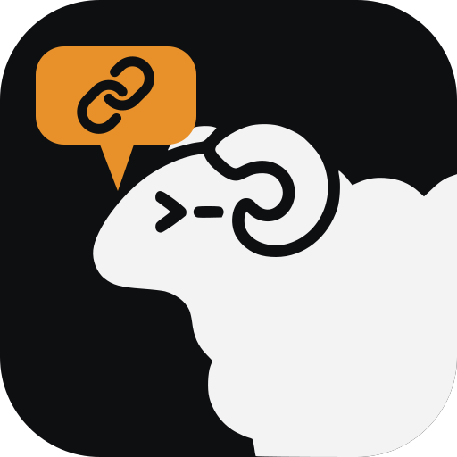

<p align="center">
  
</p>

<h1 align="center">herdr-link</h1>

Run your coding agents in [herdr](https://herdr.dev) on your computer, steer
them from your phone, in the chat app you already use.

herdr-link mirrors herdr into a chat app: every herdr space becomes a private
room, every tab a thread. Write in a thread and the tab's agent gets it; its
replies, "done" and "needs you" come back as messages with push
notifications; permission prompts come with **Allow / Deny** buttons. New
threads open new tabs, and your private chat with the bot is a control room
with a live dashboard.

Chat apps plug in as **adapters**: separate programs speaking a small JSON-RPC
protocol, in any language. **Discord** and **Telegram** are built in; [write your own](docs/adapters.md)
for anything else.

```
 your chat app (phone, desktop)
        ⇅  adapter (Discord, Telegram, or your own)
 herdr-link  ⇠  shared agent hook (Claude Code, Grok, …)
        ⇅  herdr-core, herdr app
 your agents in herdr
```

## What it does

| In herdr | In the chat (on Discord) |
| --- | --- |
| a space | a private room (a category only you and the bot see) |
| a tab | a thread named with its agent's emoji (a channel `✳️main`) |
| the agent replies | its reply in the thread |
| the agent works on a long turn | one status message, edited live: time spent and its latest notes |
| the agent finishes / needs you | "✅ Done" / "⚠️ Needs you" |
| a permission prompt | 🔐 with Allow, Allow always, Deny |
| a tab or space closed | its thread moves to `📦 archive`, deleted after 7 days |

| In the chat | In herdr |
| --- | --- |
| a message in a tab's thread | typed into its agent (files are put beside it) |
| a new thread `✳️api` in a space's room | a new tab with that agent (no emoji: the bot asks) |
| a deleted thread | its tab is closed |
| a task in your private chat with the bot | a new tab in the space you pick, the task as its first message |
| `/screen`, `/status`, `/space new` | the agent's screen, every agent's state, a new space |

Agents are configuration, not code: Claude Code and Grok are set up out of the
box (their Allow / Deny keys are verified against the real apps), and any
program can be an agent. See [agents](docs/agents.md).

## Install

On **macOS or Linux**, with Node 24:

```sh
npm install -g @thl-ai/herdr-link
herdr-link init
```

`herdr-link init` walks you through the rest and only asks what it cannot find
out: it checks herdr, takes your bot token (and tells you how to make one),
turns on what the bot needs, finds your user ID and server (or gives you the
invite link), picks up the agents on your PATH, writes the config, installs
the agent hooks and starts herdr-link in the background (launchd on macOS, a
systemd user unit on Linux).

No herdr yet? `init` offers to install it with its official installer. The
whole path, bot included: [getting started](docs/getting-started.md).

```
herdr-link doctor [--fix]        # check every piece; --fix repairs what it can
herdr-link service status | logs | install | uninstall
herdr-link hooks install | uninstall
herdr-link telegram              # find the ids a Telegram setup needs
herdr-link run                   # in the foreground instead of the service
```

### Discord

`init` sets up the built-in Discord adapter. Afterwards, in Discord: allow the
bot's commands only for yourself (Server Settings → Integrations), and set its
categories to *All Messages* to get pushes.

<details>
<summary>Doing it by hand</summary>

1. Create the bot at <https://discord.com/developers/applications>: *New
   Application*; on **Installation** set *Install Link* to *None*; on **Bot**
   turn off *Public Bot*, turn on *Message Content Intent*, *Reset Token* and
   copy it. Optionally upload your agents' logos under **Emojis** (`claude`,
   `grok`).
2. Invite it with your Application ID:
   `https://discord.com/oauth2/authorize?client_id=APP_ID&scope=bot+applications.commands&permissions=275146443856`
   (View Channels, Send Messages, Send Messages in Threads, Read Message
   History, Attach Files, Add Reactions, Manage Channels, Manage Roles; no
   Administrator).
3. Copy [`config.example.toml`](config.example.toml) to
   `~/.config/herdr-link/config.toml` and set `owner` (your user ID) and
   `guild` (the server ID; Developer Mode, right-click, Copy ID). Put
   `DISCORD_TOKEN=...` in `~/.config/herdr-link/.env`.
4. `herdr-link hooks install`, then `herdr-link service install`.

</details>

### Telegram

Every herdr tab becomes a topic `✳️space / tab` in a group of yours (Topics
on, the bot an admin with *Manage topics*); your private chat with the bot is
the control room. Create the bot with @BotFather, put `TELEGRAM_TOKEN=...` in
`~/.config/herdr-link/.env`, write in the group and press *Start* in the
bot's chat, then `herdr-link telegram` prints the config section to add.
Step by step: [getting started](docs/getting-started.md#telegram-the-bot-and-the-group).

## More than one computer

- **One herdr, several machines** (`hc machine add`): one herdr-link sees them
  all; spaces on another machine get its name, like `api · build-box`.
- **Separate computers, each with its own herdr:** run herdr-link on each,
  **with its own bot** (`herdr-link init` sets one up). Two copies sharing one
  bot would both answer your private chat and the commands. Answer yes when
  `init` asks about other computers: it sets `machine` in the config, so each
  computer's rooms read `api · laptop`, `api · desktop`.

## Split tabs

A tab split into several panes keeps one thread. The panes sign their
messages (`✳️ claude · …`). Reply to a message to answer that pane, start with
an agent's emoji (`⚪ check the tests`) to pick an agent, or just write and
the bot asks who it is for.

## Documentation

- [Getting started](docs/getting-started.md): from nothing to your phone, step by step
- [Configuration](docs/configuration.md): every setting, file and path
- [Agents](docs/agents.md): adding an agent, finding its keys, the hook
- [Writing an adapter](docs/adapters.md): bring herdr-link to another chat app
- [Troubleshooting](docs/troubleshooting.md): `doctor` and common problems
- [Roadmap](docs/roadmap.md): the way to 1.0

## Security

Whoever can write in the bot's threads can run code on your machine. The
adapter checks every message, reaction, button and command against your user
ID, the rooms are private, and the hook talks to herdr-link over a unix socket
only you can open. Don't send secrets through it: the chat platform sees
everything.

**Install only adapters you trust.** An adapter can type into your agents'
terminals. It only sees the environment variables its config section lists in
`env`.

## Development

```sh
pnpm typecheck
pnpm test
pnpm schema      # after changing the protocol
```

TypeScript 7 and [Effect 4](https://effect.website). The architecture, the
decisions behind it and what we learned about herdr-core, Claude Code and Grok
are in [CLAUDE.md](CLAUDE.md).

## License

[MIT](LICENSE). The ram in the logo is herdr's own.
